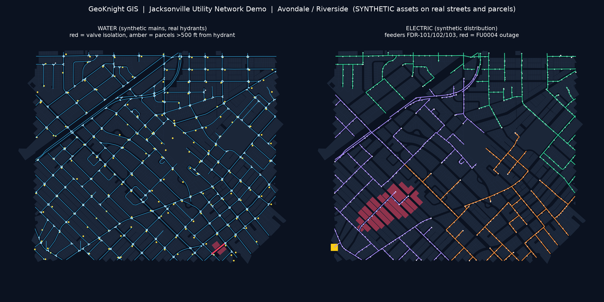

# GeoKnight GIS: Jacksonville Utility Network Demo

**Water and electric network topology, QC, valve-isolation and outage traces, and hydrant coverage for Avondale/Riverside, Jacksonville FL.**
By Christopher Knight · [knightchrism.github.io](https://knightchrism.github.io) · GitHub [@knightchrism](https://github.com/knightchrism)

> ⚠️ **Synthetic network data.** JEA does not publish its pipe or wire networks. Every water main, valve, service line, meter, primary conductor, fuse, transformer, service drop, and the substation in this repo is **synthetic**: generated on real streets and parcels, and labeled `synthetic_*` in every filename and layer. Real inputs are labeled `real_*`.



## Problem
Utility GIS teams keep connected network models current and use them to answer operational questions: *Which valves isolate a main break? Who loses power when this fuse operates? Which parcels are too far from a hydrant? Where is the network topologically broken?* This repo answers those questions end to end with an open Python stack.

## Data sources and licenses
| Layer | Source | Status |
|---|---|---|
| Street centerlines | US Census TIGERweb (public domain) | real |
| Parcels (2,789 in the study area) | FL Dept. of Revenue statewide cadastral (public) | real |
| Fire hydrants (206 in the study area, 32,697 countywide) | City of Jacksonville / JEA hydrant service (public ArcGIS REST) | real |
| Transmission lines (132 in the Duval bbox) | HIFLD Open | real |
| Water mains, valves, services, meters, hydrant laterals | generated | **synthetic** |
| Substation, feeders, fuses, transformers, service drops | generated | **synthetic** |

Endpoint tests, counts, and gaps are in [DATA_SOURCES.md](DATA_SOURCES.md).

## Methods
1. **Fetch** (`jaxnet-fetch`): paged ArcGIS REST queries into `data/raw/` (gitignored).
2. **Build** (`jaxnet-build`): node the TIGER streets at intersections, then lay the network on top:
   - Water mains follow the centerlines. A valve goes on every leg 20 ft from each intersection. Each FDOR parcel gets a service line and meter tapped to the nearest main. The real hydrants are snapped to the mains with laterals.
   - Electric starts from a synthetic substation tied to the nearest real HIFLD line. A radial minimum spanning tree over the streets gives the primary, split into 3 balanced feeders. Trunk segments are 3-phase and laterals are single-phase, with fuses at the lateral taps. Transformers serve about 6 customers each, with a service drop to every parcel.
   - QC defects are planted on purpose and flagged `qc_injected=1`.
3. **Analyze** (`jaxnet-analyze`), built on networkx graphs:
   - Topology QC: disconnected islands, short dangles, missing diameter, duplicate geometry, valves off a main, unconnected transformers, missing phase or voltage.
   - Main-break valve isolation: a graph walk outward from the break that stops at valves.
   - Fuse outage: downstream walk on the directed radial feeder.
   - Hydrant coverage: parcels more than 500 ft (straight line) from a real hydrant, counting hydrants up to about 1,000 ft outside the study area to avoid edge effects.

## Run it
```bash
uv sync
uv run jaxnet-fetch     # real data -> data/raw (about 3 min)
uv run jaxnet-build     # synthetic networks -> data/processed/jax_utility_network.gpkg + data/synthetic/*.geojson
uv run jaxnet-analyze   # QC + traces -> outputs/, web/index.html
```

## Outputs
- `web/index.html`: interactive Leaflet map with toggleable layers
- `data/processed/jax_utility_network.gpkg`: all layers plus trace results (regenerated; gitignored)
- `data/synthetic/*.geojson`: synthetic network layers (committed)
- `outputs/qc_report.md`, `outputs/results.json`, `outputs/jax_utility_network_map.png`

## Results
| Metric | Value |
|---|---|
| Synthetic assets | 1418 main segments, 848 valves, 2789 services and meters, 416 primary segments, 82 fuses, 629 transformers |
| QC: disconnected water mains | 6 (in 3 islands) |
| QC: short dangles / missing diameter / duplicates / valves off main | 17 / 6 / 2 / 3 |
| QC: unconnected transformers / missing phase (xfmr, primary) / missing voltage | 2 / 2, 3 / 2 |
| Main break WM00645 | close 4 valves, 5 mains out of service, **5 parcels without water** |
| Fuse FU0004 (FDR-101) | 25 transformers, **139 customers out** |
| Feeder loading (customers) | FDR-101: 1110, FDR-102: 937, FDR-103: 742 |
| Parcels > 500 ft from a real hydrant | **0 of 2789** (0.0%). Riverside's real hydrant grid is dense |

Full details: [outputs/qc_report.md](outputs/qc_report.md)

## Roadmap
- Load into PostGIS with pgRouting for SQL-side traces (PostgreSQL client is on the box; no server is running yet)
- Sewer gravity network (flow direction by DEM) and reclaimed water
- OSM power layers through a Geofabrik extract
- FEMA flood-zone exposure of assets

---
GeoKnight GIS · Christopher Knight
